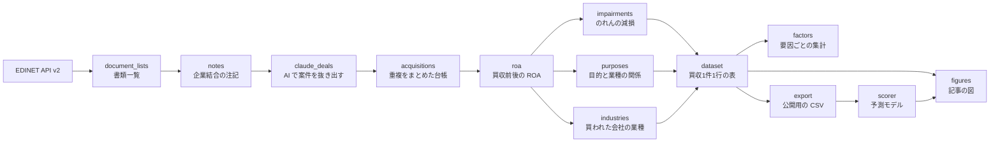

# edinet-ma-ledger

[](https://github.com/Asmirai/edinet-ma-ledger/actions/workflows/ci.yml)
[](LICENSE)

上場企業の有価証券報告書（以下、有報）から買収（M&A）の台帳を作り、その買収が失敗するか（買収から3年以内にのれんを減損するか）を予測するモデルを公開しています。

- 記事：[M&A 2,429件のデータから、失敗する買収を見抜くAIを作った（Qiita）](https://qiita.com/ykuchiki/items/18d31329d81581d56a61)
- 台帳（CSV）：[Releases](https://github.com/Asmirai/edinet-ma-ledger/releases/latest)

## 分かったこと

2016〜2022年度の買収2,429件のうち、6件に1件が3年以内にのれんを減損していました。買う前に分かる4つの変数（上乗せ率、業種の関係、買い手の自己資本比率、買い手に対する買収の大きさ）で作ったロジスティック回帰は、学習に使っていない2020年度以降の869件で、失敗率に約10倍の差をつけました。


分析の流れと限界（変数の選び方、確率の較正、因果とは言えないこと）は記事に書いています。

## すぐ試す

[uv](https://docs.astral.sh/uv/) が入っていれば、台帳の CSV を取るだけで、記事のモデルを動かせます。EDINET の API キーは要りません。

```bash
git clone https://github.com/Asmirai/edinet-ma-ledger.git
cd edinet-ma-ledger
mkdir -p data/public
curl -L -o data/public/ma_ledger.csv \
  https://github.com/Asmirai/edinet-ma-ledger/releases/latest/download/ma_ledger.csv

uv run python -m ledger.scorer examples/candidates.csv
```

```text
B社	9.0%
C社	18.3%
E社	20.7%
D社	34.2%
```

候補ごとに、3年以内にのれんを減損する確率の見積もりが、低い順に出ます。モデルは、台帳のうち4つの変数と成否がそろう1,719件すべてで学習します。

候補の CSV（[examples/candidates.csv](examples/candidates.csv)）の列は次のとおりです。金額の単位は、そろえれば何でも構いません。

| 列 | 内容 |
|---|---|
| `name` | 候補の名前 |
| `price` | 想定の買収額 |
| `target_net_assets` | 相手の純資産（資産から負債を引いた額）。一部だけ買うなら、取得する持分の割合を掛けた額 |
| `acquirer_assets` | 自社の総資産 |
| `equity_ratio` | 自社の自己資本比率（0〜1） |
| `relatedness` | 相手との業種の関係。`同業種`・`関連業種`・`異業種` のどれか |

学習に使っていない年で確かめた結果は、引数なしで出せます。

```bash
uv run python -m ledger.scorer   # data/scorer.md に、5つの群ごとの失敗率と AUC を書く
```

確率は、過去の似た買収のうち、のれんを減損したものの割合の見積もりです。相手の事業の将来性は入っていません。危ない側では実際より低めに出ます。候補の順位付けの材料として使ってください。

## 台帳（CSV）

`ma_ledger.csv` は、有報（2016年10月〜2025年9月提出）の「企業結合等関係」の注記に書かれた買収を、1行1件にまとめたものです。6,405行（買収6,324件）あります。列の意味と注意点は [docs/ma_ledger_csv.md](docs/ma_ledger_csv.md) にあります。

名前と金額は、AI（Claude）が注記から抜き出した値です。原文に載っているかをプログラムで照合しています。156件を原文と見比べた抜き取りでは、取得原価の誤りは2件（1.3%）でした。

## 処理の流れ



| モジュール | やること |
|---|---|
| `edinet` | EDINET API v2 の呼び出し |
| `document_lists`・`notes` | 書類一覧を取り、有報から「企業結合等関係」の注記を取り出す |
| `claude_deals` | 注記を Claude Code のサブエージェントに渡す入力に分け、出力を原文と照合する |
| `deals` | 注記の選び方・原文との照合・金額の換算（抜き出し・台帳・採点で共通） |
| `acquisitions` | 同じ案件の重複をまとめ、金額を円に直した台帳を作る |
| `review` | 注記を無作為に選び、抜き出しの誤り率を採点する |
| `roa` | 有報の「主要な経営指標等の推移」から、買収前後の ROA を出す |
| `impairments`・`purposes`・`industries`・`profiles` | 減損、目的と業種の関係、買われた会社の業種、買い手の財務を付ける |
| `features`・`dataset` | 分析に使う列を作り、買収1件1行の表にまとめる |
| `factors` | 要因ごとの減損率と、ほかの要因をそろえたロジスティック回帰 |
| `scorer` | 4つの変数の予測モデル（記事の分析4・5） |
| `predict` | ROA で成否を当てるモデル（記事の付録の「選ばなかった目的変数」） |
| `export`・`figures` | 公開用の CSV と、記事の図 |

## データの取得から作り直す

台帳を一から作るには、EDINET の API キーと、Claude Code（注記の読み取りをサブエージェントに任せるため）が要ります。

1. EDINET の閲覧サイトでアカウントを作って API キーを取り、`cp .env.example .env` で作った `.env` の `EDINET_API_KEY` に書く（`.env` はコミットしない）
2. `uv sync` で依存を入れる

<details>
<summary>手順</summary>

### 書類一覧と注記を取る

```bash
uv run --env-file .env python -m ledger.document_lists 2024-10-01 2025-09-30
uv run --env-file .env python -m ledger.notes 2024-10-01 2025-09-30
```

`document_lists` は、期間の各日の書類一覧を `data/document_lists/YYYY-MM-DD.json` に保存します。`notes` は、期間に提出された会社の有報（ファンドを除く）の CSV の ZIP を `data/documents/` に保存し、「企業結合等関係」の注記の文章を `data/notes/{docID}.json` に保存します。どちらも1秒ずつ空けて呼び、保存済みのものは取り直しません。当日の一覧はまだ増えるので、終わりの日は昨日以前にします。

### 注記から買収案件を抜き出し、台帳にする

```bash
uv run python -m ledger.claude_deals split 2023-10-01 2024-09-30 data/claude_deals/y2024
# in/chunk_NNN.jsonl を1つずつ Claude Code のサブエージェントに渡し、
# ledger/claude_deals_instructions.md の指示で out/chunk_NNN.json に書かせる
uv run python -m ledger.claude_deals check data/claude_deals/y2024
uv run python -m ledger.acquisitions
```

`check` は、出力を入力の原文と照らし合わせます。出力の無い入力や、注記の並びが入力と違う出力があれば止まります。`acquisitions` は、同じ会社の後の有報に載った同じ案件（同じ名前で、企業結合日が1年以内）を1行にまとめ、`data/acquisitions.csv` に書きます。親会社と子会社が同じ会社を買っていれば、行は会社ごとに残して同じ `deal_id` を付けます。

### 抜き出しの誤り率を出す

```bash
uv run python -m ledger.review sample data/review
# in/chunk_NNN.jsonl を Opus のサブエージェントに渡し、ledger/review_instructions.md の指示で採点させる
uv run python -m ledger.review score data/review
```

### 減損・目的・業種を付ける

```bash
uv run python -m ledger.roa
uv run python -m ledger.industries split data/industries     # ledger/industry_instructions.md
uv run python -m ledger.impairments split data/impairments   # ledger/impairment_instructions.md
uv run python -m ledger.impairments label data/impairments
uv run python -m ledger.purposes split data/purposes         # ledger/purpose_instructions.md
```

`split` で分けた入力は、それぞれの指示のファイルとともにサブエージェントに渡します。`roa` は、買収前後の ROA を `data/acquisitions_roa.csv` に書きます。決算期の変更や、会計基準・連結と単体が変わる期をまたぐものは、理由を付けて空にします。

### 集計・公開用の CSV・モデル・図

```bash
uv run python -m ledger.factors    # data/factors.md
uv run python -m ledger.export     # data/public/ma_ledger.csv
uv run python -m ledger.scorer     # data/scorer.md
uv run python -m ledger.predict    # data/predict.md
uv run --group figures python -m ledger.figures <出力するフォルダ>   # 記事の図（macOS のヒラギノ角ゴシックを使う）
```

</details>

## 開発

```bash
uv sync
uv run pytest
uv run ruff check . && uv run ruff format --check .
uv run basedpyright
```

テストは対象と同じフォルダの `*.test.py` に、日本語の関数名で書いています（集め方は [conftest.py](conftest.py)）。テストは `data/` を使わないので、EDINET の書類が無くても通ります。

## 出典とライセンス

出典：EDINET閲覧（提出）サイト（https://disclosure2.edinet-fsa.go.jp/ ）、公共データ利用規約（第1.0版）（https://www.digital.go.jp/resources/open_data/public_data_license_v1.0 ）。台帳は、合同会社Asmirai が有報から AI を使って買収の記載を抜き出し、加工したものです。国が作成した情報そのものではありません。台帳を使うときは、この出典と加工の記載を表示してください。

コードは MIT ライセンス（[LICENSE](LICENSE)）です。

## English summary

A ledger of 6,324 M&A deals that Claude extracted from the business-combination notes in Japanese annual securities reports (EDINET, filed 2016–2025), and a logistic-regression model that predicts whether an acquisition leads to a goodwill impairment within three years. Four pre-deal variables (premium over net assets, industry relation, the acquirer's equity ratio, and deal size relative to the acquirer) separated the impairment rate by about 10× on a time-based holdout (deals from 2020–2022). Download the CSV from Releases and run `uv run python -m ledger.scorer examples/candidates.csv`. Data: EDINET under the Public Data License 1.0, processed by Asmirai LLC. Code: MIT.
