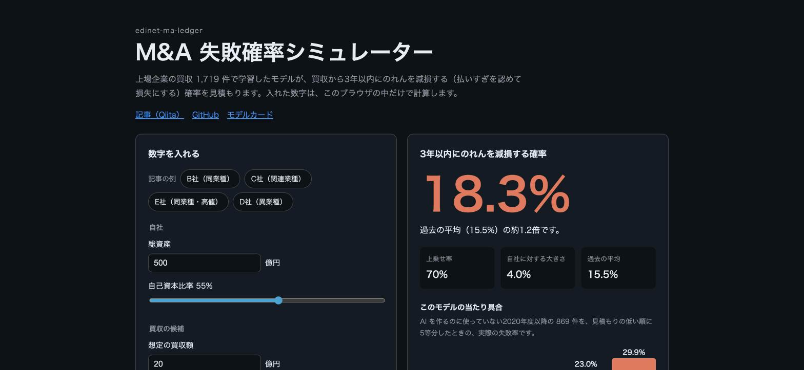
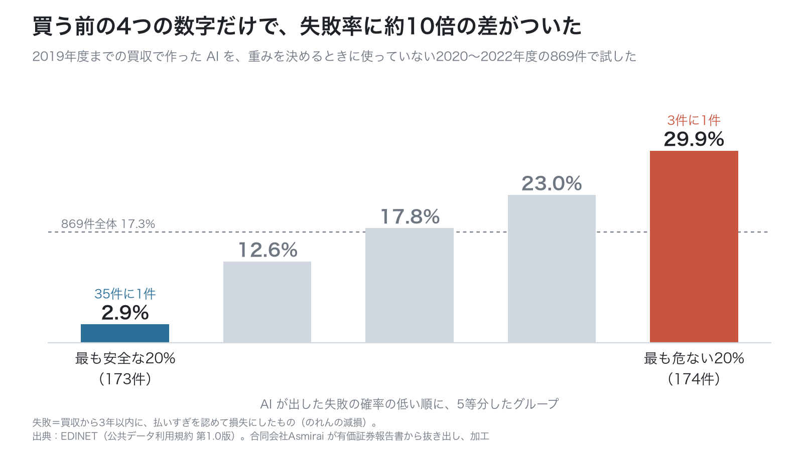
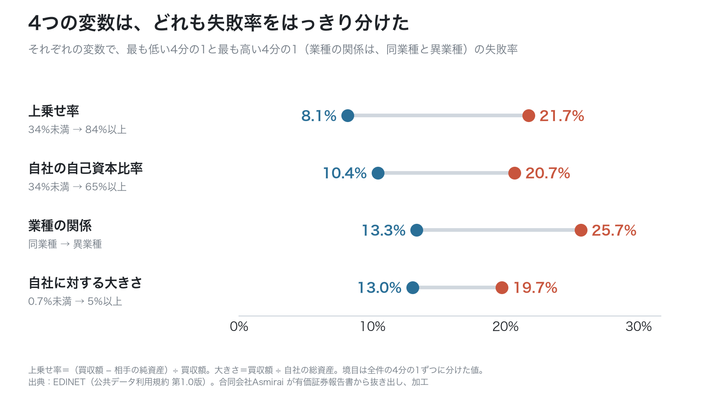
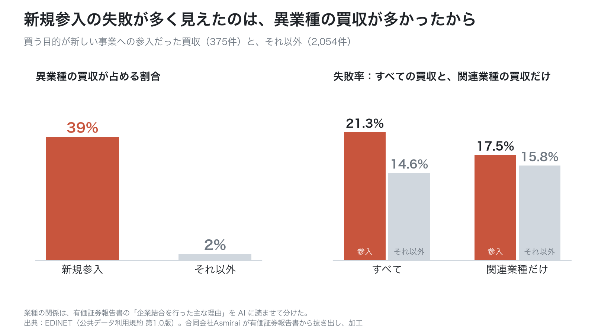
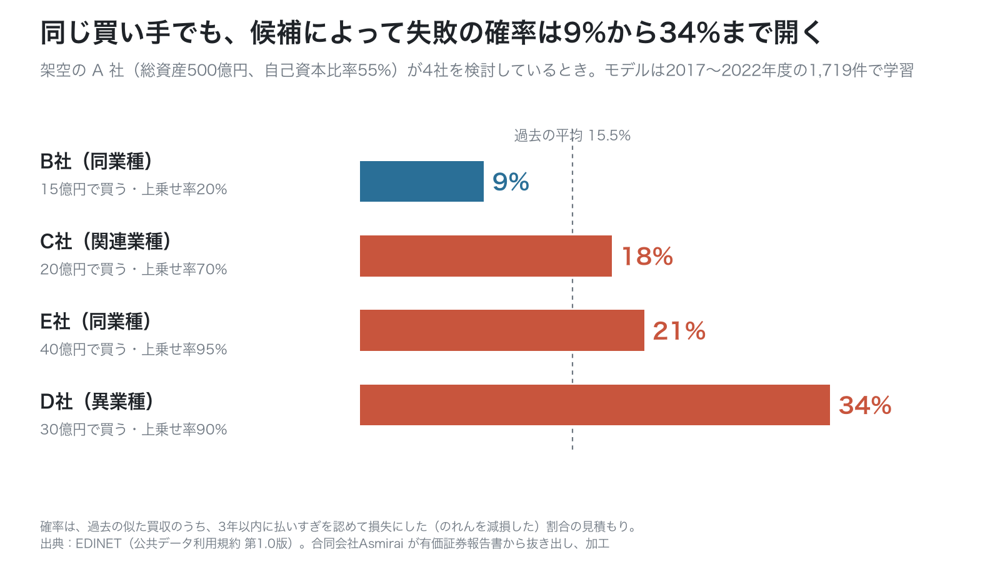
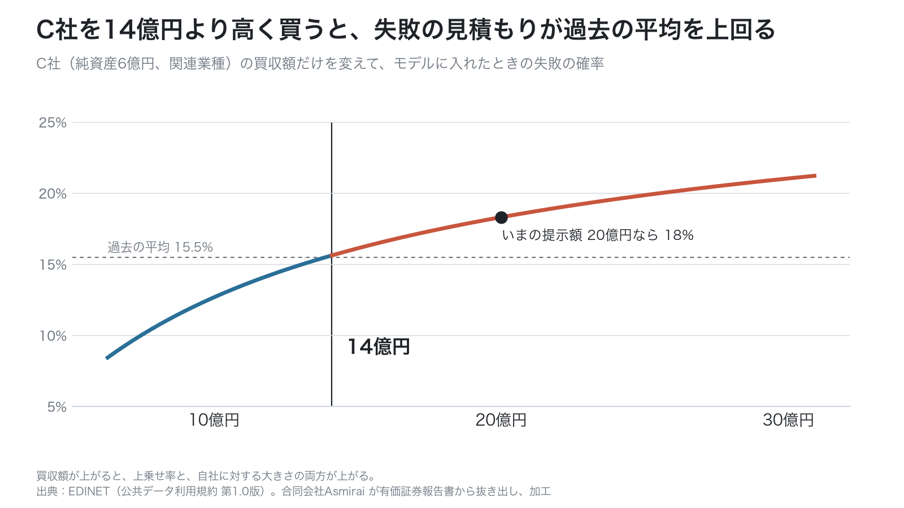
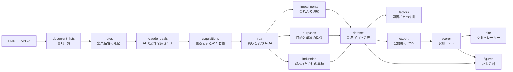

<div align="center">

# edinet-ma-ledger

**上場企業の買収 6,324 件の台帳と、買収の失敗（のれんの減損）を予測するモデル**

[](https://github.com/Asmirai/edinet-ma-ledger/actions/workflows/ci.yml)
[](https://asmirai.github.io/edinet-ma-ledger/)
[](LICENSE)
[](pyproject.toml)
[](https://github.com/astral-sh/uv)
[](https://github.com/astral-sh/ruff)
[](https://www.digital.go.jp/resources/open_data/public_data_license_v1.0)

[シミュレーター](https://asmirai.github.io/edinet-ma-ledger/) ・ [記事（Qiita）](https://qiita.com/ykuchiki/items/18d31329d81581d56a61) ・ [台帳（CSV）](https://github.com/Asmirai/edinet-ma-ledger/releases/latest) ・ [ノートブック](notebooks/quickstart.ipynb) ・ [モデルカード](docs/model_card.md)

</div>

上場企業の有価証券報告書（以下、有報）の「企業結合等関係」の注記から、AI（Claude）で買収の記載を抜き出し、2016年10月〜2025年9月提出の分を台帳にしました。その台帳で、買う前に分かる4つの数字から、買収から3年以内にのれんを減損する（払いすぎを認めて損失にする）確率を予測するモデルを作っています。

[](https://asmirai.github.io/edinet-ma-ledger/)

## 目次

- [分かったこと](#分かったこと)
- [試す](#試す)
- [台帳（CSV）](#台帳csv)
- [処理の流れ](#処理の流れ)
- [ドキュメント](#ドキュメント)
- [よくある質問](#よくある質問)
- [データの取得から作り直す](#データの取得から作り直す)
- [開発](#開発)
- [引用と出典とライセンス](#引用と出典とライセンス)
- [English summary](#english-summary)

## 分かったこと

2016〜2022年度の買収2,429件のうち、15.6%（約6件に1件）が3年以内にのれんを減損していました。買う前に分かる4つの変数で作ったロジスティック回帰は、学習に使っていない2020年度以降の869件で、失敗率に約10倍の差をつけました。



| 確率の低い順に5等分した群 | 件数 | 実際の失敗率 | モデルの確率の平均 |
|---|---:|---:|---:|
| 1（最も安全） | 173 | 2.9% | 7.5% |
| 2 | 174 | 12.6% | 10.2% |
| 3 | 174 | 17.8% | 12.5% |
| 4 | 174 | 23.0% | 15.2% |
| 5（最も危ない） | 174 | 29.9% | 20.4% |

AUC は0.687です（0.5で当てずっぽう、1で全問正解）。モデルの確率は、危ない側で実際より低めに出ます。

<table>
  <tr>
    <td width="50%"><br /><sub>上乗せ率・自己資本比率・業種の関係・大きさは、どれも失敗率を分けた。借金の少ない会社ほど失敗が多い</sub></td>
    <td width="50%"><br /><sub>新規参入が危なく見えたのは、異業種の買収を多く含むから（交絡）</sub></td>
  </tr>
  <tr>
    <td width="50%"><br /><sub>同じ買い手でも、候補によって失敗の確率は9%から34%まで開く</sub></td>
    <td width="50%"><br /><sub>買収額だけを変えると、14億円を超えたところで見積もりが過去の平均を上回る</sub></td>
  </tr>
</table>

分析の流れと限界（変数の選び方、確率の較正、因果とは言えないこと）は、[記事](https://qiita.com/ykuchiki/items/18d31329d81581d56a61)と[モデルカード](docs/model_card.md)にあります。

## 試す

どれも、公開している台帳の CSV だけで動きます。EDINET の API キーは要りません。

| 方法 | 向いている人 | 始め方 |
|---|---|---|
| ブラウザ | 数字を入れて確率を見たい | [シミュレーター](https://asmirai.github.io/edinet-ma-ledger/)を開く。入れた数字はブラウザの外に送りません |
| ノートブック | EDA からモデルまでをたどりたい | [](https://colab.research.google.com/github/Asmirai/edinet-ma-ledger/blob/main/notebooks/quickstart.ipynb) |
| コマンド | 自分の候補をまとめて並べたい | 下の手順 |

[uv](https://docs.astral.sh/uv/) で動かす手順です。

```bash
git clone https://github.com/Asmirai/edinet-ma-ledger.git
cd edinet-ma-ledger
mkdir -p data/public
curl -L -o data/public/ma_ledger.csv \
  https://github.com/Asmirai/edinet-ma-ledger/releases/latest/download/ma_ledger.csv

uv run python -m ledger.scorer examples/candidates.csv
```

```text
B社	9.0%
C社	18.3%
E社	20.7%
D社	34.2%
```

候補ごとに、3年以内にのれんを減損する確率の見積もりが、低い順に出ます。モデルは、台帳のうち4つの変数と成否がそろう1,719件（2017〜2022年度）すべてで学習します。候補の CSV（[examples/candidates.csv](examples/candidates.csv)）の列は次のとおりです。金額の単位は、そろえれば何でも構いません。

| 列 | 内容 |
|---|---|
| `name` | 候補の名前 |
| `price` | 想定の買収額 |
| `target_net_assets` | 相手の純資産（資産から負債を引いた額）。一部だけ買うなら、取得する持分の割合を掛けた額 |
| `acquirer_assets` | 自社の総資産 |
| `equity_ratio` | 自社の自己資本比率（0〜1） |
| `relatedness` | 相手との業種の関係。`同業種`・`関連業種`・`異業種` のどれか |

```bash
uv run python -m ledger.scorer          # 学習に使っていない年で確かめ、data/scorer.md に書く
uv run python -m ledger.scorer --help   # 使い方
```

## 台帳（CSV）

`ma_ledger.csv` は、有報の注記に書かれた買収を1行1件にまとめたものです。6,405行（買収6,324件）あります。買い手・相手・企業結合日・取得原価・のれん・業種の関係・買い手の自己資本比率・買収後3年以内の減損・ROA の変化を含みます。列の意味と注意点は [docs/ma_ledger_csv.md](docs/ma_ledger_csv.md) にあります。

名前と金額は、AI が注記から抜き出した値です。原文に載っているかをプログラムで照合しています。156件を原文と見比べた抜き取りでは、取得原価の誤りは2件（1.3%）でした。誤りを見つけたら、[台帳の誤りの報告](https://github.com/Asmirai/edinet-ma-ledger/issues/new?template=data_error.yml)から知らせてください。

## 処理の流れ



| モジュール | やること |
|---|---|
| `edinet` | EDINET API v2 の呼び出し |
| `document_lists`・`notes` | 書類一覧を取り、有報から「企業結合等関係」の注記を取り出す |
| `claude_deals` | 注記を Claude Code のサブエージェントに渡す入力に分け、出力を原文と照合する |
| `deals` | 注記の選び方・原文との照合・金額の換算（抜き出し・台帳・採点で共通） |
| `acquisitions` | 同じ案件の重複をまとめ、金額を円に直した台帳を作る |
| `review` | 注記を無作為に選び、抜き出しの誤り率を採点する |
| `roa` | 有報の「主要な経営指標等の推移」から、買収前後の ROA を出す |
| `impairments`・`purposes`・`industries`・`profiles` | 減損、目的と業種の関係、買われた会社の業種、買い手の財務を付ける |
| `features`・`dataset` | 分析に使う列を作り、買収1件1行の表にまとめる |
| `public` | 公開台帳の置き場所・列・値の種類・成否を付けられる最後の年 |
| `factors` | 要因ごとの減損率と、ほかの要因をそろえたロジスティック回帰 |
| `scorer` | 4つの変数の予測モデル（記事の分析4・5）。`public` だけに依存する |
| `predict` | ROA で成否を当てるモデル（記事の付録の「選ばなかった目的変数」） |
| `export`・`figures` | 公開用の CSV と、記事の図 |
| `site/` | ブラウザのシミュレーター。`model.js` が Python と同じ式で確率を計算する |

保存するファイルの一覧は [AGENTS.md](AGENTS.md) にあります。

## ドキュメント

| 文書 | 内容 |
|---|---|
| [docs/model_card.md](docs/model_card.md) | モデルの用途・使ってはいけない用途・データ・性能・較正・限界 |
| [docs/ma_ledger_csv.md](docs/ma_ledger_csv.md) | 台帳の列の意味と注意点 |
| [docs/decisions/](docs/decisions/) | 決めたことと理由（目的変数、業種の関係の名前、公開 CSV からの学習、CI の置き場所、ブラウザのシミュレーター） |
| [CONTRIBUTING.md](CONTRIBUTING.md) | 参加のしかた、テストの書き方、ブランチと PR の流れ |
| [AGENTS.md](AGENTS.md) | 作業する人と AI エージェント向けの決まり、データの流れと保存するファイル |
| [CHANGELOG.md](CHANGELOG.md) | これまでの変更 |
| [SECURITY.md](SECURITY.md) | 脆弱性の報告先 |

## よくある質問

<details>
<summary>なぜ「失敗」を、買い手全体の利益率（ROA）でなく、のれんの減損で測るのですか</summary>

買収の約半分は、払った金額が買い手の総資産の2%に届きません。総資産1,000億円の会社が20億円の会社を買っても、会社全体の利益は、本業の景気や為替のほうが大きく動かします。ROA を目的変数にしたモデルは、AUC 0.51 で当てずっぽうと変わりませんでした。のれんの減損は、1件の買収ごとに、会社が自分で「払いすぎた」と認めた記録です。詳しくは [docs/decisions/17-impairment-target.md](docs/decisions/17-impairment-target.md) にあります。
</details>

<details>
<summary>上乗せ率が高いと、失敗の原因になるのですか</summary>

原因とまでは言えません。上乗せ率が高い買収は、もともと難しい案件なのかもしれません。分かっているのは、ほかの条件（大きさ・目的・業種の関係・対価・買い手の財務と業績・年）をそろえても、上乗せ率が高いほど減損が多いという関係までです。
</details>

<details>
<summary>自社の業界に合わせたモデルを作れますか</summary>

台帳の CSV を自社の業界の買収だけに絞り、`ledger.scorer` の `fit_scorer` で学習し直せます。件数が少ないと結果がぶれるので、関連業種をまとめて件数を確保してください。自社で集められる変数を足すこともできます。
</details>

<details>
<summary>台帳を商用に使えますか</summary>

使えます。台帳は EDINET の情報を、公共データ利用規約（第1.0版）に沿って加工したものです。使うときは、出典（EDINET）と、合同会社Asmirai が加工したことを表示してください。コードは MIT ライセンスです。
</details>

<details>
<summary>台帳の値が原文と違っていました</summary>

[台帳の誤りの報告](https://github.com/Asmirai/edinet-ma-ledger/issues/new?template=data_error.yml)から、`deal_id`・列・正しい値・出典の書類番号（docID）を知らせてください。
</details>

## データの取得から作り直す

台帳を一から作るには、EDINET の API キーと、Claude Code（注記の読み取りをサブエージェントに任せるため）が要ります。

1. EDINET の閲覧サイトでアカウントを作って API キーを取り、`cp .env.example .env` で作った `.env` の `EDINET_API_KEY` に書く（`.env` はコミットしない）
2. `uv sync` で依存を入れる

<details>
<summary>手順</summary>

### 書類一覧と注記を取る

```bash
uv run --env-file .env python -m ledger.document_lists 2024-10-01 2025-09-30
uv run --env-file .env python -m ledger.notes 2024-10-01 2025-09-30
```

`document_lists` は、期間の各日の書類一覧を `data/document_lists/YYYY-MM-DD.json` に保存します。`notes` は、期間に提出された会社の有報（ファンドを除く）の CSV の ZIP を `data/documents/` に保存し、「企業結合等関係」の注記の文章を `data/notes/{docID}.json` に保存します。どちらも1秒ずつ空けて呼び、保存済みのものは取り直しません。当日の一覧はまだ増えるので、終わりの日は昨日以前にします。

### 注記から買収案件を抜き出し、台帳にする

```bash
uv run python -m ledger.claude_deals split 2023-10-01 2024-09-30 data/claude_deals/y2024
# in/chunk_NNN.jsonl を1つずつ Claude Code のサブエージェントに渡し、
# ledger/claude_deals_instructions.md の指示で out/chunk_NNN.json に書かせる
uv run python -m ledger.claude_deals check data/claude_deals/y2024
uv run python -m ledger.acquisitions
```

`check` は、出力を入力の原文と照らし合わせます。出力の無い入力や、注記の並びが入力と違う出力があれば止まります。`acquisitions` は、同じ会社の後の有報に載った同じ案件（同じ名前で、企業結合日が1年以内）を1行にまとめ、`data/acquisitions.csv` に書きます。親会社と子会社が同じ会社を買っていれば、行は会社ごとに残して同じ `deal_id` を付けます。

### 抜き出しの誤り率を出す

```bash
uv run python -m ledger.review sample data/review
# in/chunk_NNN.jsonl を Opus のサブエージェントに渡し、ledger/review_instructions.md の指示で採点させる
uv run python -m ledger.review score data/review
```

### 減損・目的・業種を付ける

```bash
uv run python -m ledger.roa
uv run python -m ledger.industries split data/industries     # ledger/industry_instructions.md
uv run python -m ledger.impairments split data/impairments   # ledger/impairment_instructions.md
uv run python -m ledger.impairments label data/impairments
uv run python -m ledger.purposes split data/purposes         # ledger/purpose_instructions.md
```

`split` で分けた入力は、それぞれの指示のファイルとともにサブエージェントに渡します。`roa` は、買収前後の ROA を `data/acquisitions_roa.csv` に書きます。決算期の変更や、会計基準・連結と単体が変わる期をまたぐものは、理由を付けて空にします。

### 集計・公開用の CSV・モデル・図

```bash
uv run python -m ledger.factors                                  # data/factors.md
uv run python -m ledger.export                                   # data/public/ma_ledger.csv
uv run python -m ledger.scorer                                   # data/scorer.md
uv run python -m ledger.scorer --export-model site/model.json    # シミュレーターのモデル
uv run python -m ledger.predict                                  # data/predict.md
uv run --group figures python -m ledger.figures <出力するフォルダ>  # 記事の図（macOS のヒラギノ角ゴシックを使う）
```

</details>

## 開発

```bash
uv sync
uv run pytest -q --cov
uv run ruff check . && uv run ruff format --check .
uv run basedpyright
node --test site/model.test.mjs
```

テストは対象と同じフォルダの `*.test.py` に、日本語の関数名で書いています（集め方は [conftest.py](conftest.py)）。テストは `data/` を使わないので、EDINET の書類が無くても通ります。CI は、カバレッジが80%を下回ると落ちます。決まりの全体は [CONTRIBUTING.md](CONTRIBUTING.md) と [AGENTS.md](AGENTS.md) にあります。

## 引用と出典とライセンス

このリポジトリを引用するときは、GitHub の「Cite this repository」（[CITATION.cff](CITATION.cff)）を使ってください。

出典：EDINET閲覧（提出）サイト（https://disclosure2.edinet-fsa.go.jp/ ）、公共データ利用規約（第1.0版）（https://www.digital.go.jp/resources/open_data/public_data_license_v1.0 ）。台帳は、合同会社Asmirai が有報から AI を使って買収の記載を抜き出し、加工したものです。国が作成した情報そのものではありません。台帳を使うときは、この出典と加工の記載を表示してください。

コードは MIT ライセンス（[LICENSE](LICENSE)）です。

## English summary

A ledger of 6,324 M&A deals that Claude extracted from the business-combination notes in Japanese annual securities reports (EDINET, filed 2016–2025), and a logistic-regression model that predicts whether an acquisition leads to a goodwill impairment within three years. Four pre-deal variables (premium over net assets, industry relation, the acquirer's equity ratio, and deal size relative to the acquirer) separated the impairment rate by about 10× on a time-based holdout (deals from 2020–2022, AUC 0.687). Try it in the [browser simulator](https://asmirai.github.io/edinet-ma-ledger/), the [Colab notebook](https://colab.research.google.com/github/Asmirai/edinet-ma-ledger/blob/main/notebooks/quickstart.ipynb), or run `uv run python -m ledger.scorer examples/candidates.csv` after downloading the CSV from Releases. Data: EDINET under the Public Data License 1.0, processed by Asmirai LLC. Code: MIT.
